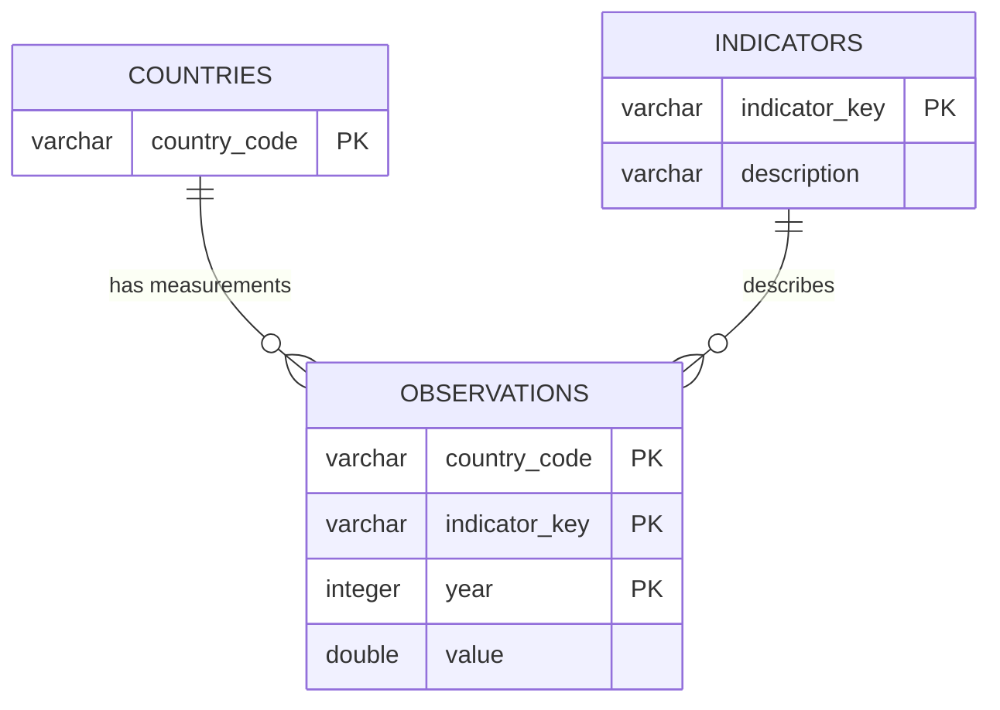

# Group 15 — The Solow Model in an Open Economy

This project applies the Solow open-economy growth model to a panel of 14 countries over 2000–2015. Using data from FRED and the World Bank API, we calibrate country-level parameters, compute steady-state values, and analyse convergence behaviour. The main deliverable is a reusable Python class (`SolowAnalyzer`) that produces summary tables, convergence plots, and counterfactual policy scenarios from a local DuckDB database.

---

## Repository structure

```
group-project-introduction-to-programming-group-project-15/
├── .gitignore
├── README.md
├── pyproject.toml
├── uv.lock
│
├── data/
│   ├── build_data.py        ← script to retrieve data and build the database (using function from the wrapper)
│   ├── solow_wrapper.py     ← functions to fetch data from FRED and World Bank APIs
│   ├── er_diagram.png       ← ER diagram of the database schema
│   └── fred_WB.db           ← generated database, committed for reproducibility
│
├── src/
│   └── your_class.py        ← SolowAnalyzer class
│
└── notebooks/
    ├── analysis.qmd         ← analysis handout (source)
    ├── analysis.html        ← rendered version
    ├── user_guide.qmd       ← user guide (source)
    └── user_guide.html      ← rendered version
```

---

## 1. Prerequisites

- **Python 3.13**, Managed by `uv`.
- **[uv](https://docs.astral.sh/uv/)** Install through the given link. Please follow the step given.
- **[Quarto](https://quarto.org/docs/get-started/)** Only needed to re-render the notebooks. You can read the committed `.html` files without it.

---

## 2. Clone the repository

```bash
git clone https://github.com/4222-Introduction-to-programming-2026/group-project-introduction-to-programming-group-project-15.git
cd group-project-introduction-to-programming-group-project-15
```

---

## 3. Install the environment
Before being able to play with the class we need to prepare the environment.

From the repository root:

```bash
uv sync
```

This reads `pyproject.toml` and `uv.lock` and creates a virtual environment in `.venv/` with the exact dependency versions used during development by downloading the necessary packages .

---

## 4. Configure the FRED API key

> **This step is only needed if you want to rebuild the database from scratch.** 
Note that the committed `data/fred_WB.db` already contains all the data used in the analysis, so the notebooks and the class run without a key.
However if you desire to build the dataset from scratch you need a FRED API that is going to be use to extract the data from fred and note that the wrapper for the World Bank API which means that no additional step need to be taken to prepare the second API.

The free FRED API key can be requested at https://fred.stlouisfed.org/docs/api/api_key.html.

Once you have it, create a `.env` file at the root of the repository in which you are going to store the key:

```
FRED_API_KEY=your_key_here
```

The `.env` file is git-ignored and must never be committed. The data retrieval script loads it automatically at runtime — you never need to hardcode the key anywhere.

Once this is done, it is possible to create the dataset by running `uv run python data/build_data.py`

---

## 5. Database schema

The data is stored in `data/fred_WB.db`, a DuckDB database organised as a star schema: one fact table (`observations`) referencing two dimension tables (`countries` and `indicators`).



- **`countries`** — one row per country, keyed by ISO-3 code. Holds the 14 countries in the sample:

  | Code | Country        | Code | Country       |
  |------|----------------|------|---------------|
  | ARG  | Argentina      | ITA  | Italy         |
  | BRA  | Brazil         | JPN  | Japan         |
  | CAN  | Canada         | KEN  | Kenya         |
  | CHN  | China          | KOR  | South Korea   |
  | FRA  | France         | SGP  | Singapore     |
  | GBR  | United Kingdom | USA  | United States |
  | GHA  | Ghana          | ZAF  | South Africa  |


- **`indicators`** : one row per economic series. Holds 5 indicators: `gdp`, `population`, `population_growth`, `savings_rate`, `labor_force`.
- **`observations`** : the fact table, one row per (country, indicator, year) triple. Covers 2000–2015: 14 × 5 × 16 = 1,120 rows.

---

## 6. Running the code

### a. Rebuild the database (optional)

```bash
uv run python data/build_data.py
```

Run this **once**. After it completes, `data/fred_WB.db` is populated and all subsequent code reads from the database only. Requires a valid FRED API key in `.env`. After running the command, build_data is going to extract the necessary function from the wrapper and create the dataset. Note that this can also be done directly from build_data.

### b. Use the class from a script or notebook

The class can be run directly as the dataset `fred_WB.db` is directly stored inside the repository. The class have access to the different observations and it going to use it for the various method.

```python
from src.your_class import SolowAnalyzer

analyzer = SolowAnalyzer()
analyzer.summary_table("USA")
analyzer.plot_convergence(["USA", "KEN", "GHA"])
```

Note that the country codes and indicator keys are **case-insensitive**: `"usa"` and `"USA"` are both valid.

### c. Render the notebooks (optional)

```bash
# macOS / Linux
export QUARTO_PYTHON=.venv/bin/python
quarto render notebooks/analysis.qmd
quarto render notebooks/user_guide.qmd

# Windows (PowerShell)
$env:QUARTO_PYTHON = ".venv\Scripts\python.exe"
quarto render notebooks/analysis.qmd
quarto render notebooks/user_guide.qmd
```

The rendered HTML files are self-contained and can be opened directly in a browser without running any code.

---

## 7. Typical workflow of class

```python
# import the class Solow Analyzer
from src.your_class import SolowAnalyzer

# import matplotlib to plot the graphs
import matplotlib.pyplot as plt

# 1. Instantiate the class
analyzer = SolowAnalyzer()

# 2. Check available countries
countries = analyzer.get_available_countries()
print(countries)

# 3. Inspect parameters for a single country
analyzer.summary_table("KEN")

# 4. Plot raw indicators across countries
analyzer.plot_indicator(["USA", "KEN", "GHA"], "savings_rate")

# 5. Compare GDP per capita trajectories
analyzer.plot_gdp_comparison(["USA", "KEN", "GHA"])

# 6. Check convergence toward the steady state
analyzer.plot_convergence(["USA", "KEN", "GHA"])

# 7. Compare steady-state income across countries
analyzer.compare_steady_states(countries)

# 8. Run a what-if scenario
analyzer.plot_scenario("KEN", new_s=0.25)

```

See `notebooks/user_guide.html` for the full method reference. 

---

## 8. Troubleshooting

**`ModuleNotFoundError`** — run `uv sync` to make sure all dependencies are installed.

**`FileNotFoundError: Database not found`** — the database file is missing. Run `uv run python data/build_data.py` to rebuild it. A valid FRED API key in `.env` is required.

**`ValueError: Unknown country`** — the country code is not in the database. Call `analyzer.get_available_countries()` to see the full list. Codes are case-insensitive, so `"ken"` and `"KEN"` both work.

**`ValueError: Unknown indicator`** — the indicator key is not one of the five valid options. Valid values are: `gdp`, `population`, `population_growth`, `savings_rate`, `labor_force`. Indicator keys are also case-insensitive.

**`Quarto render fails with ModuleNotFoundError`** — set `QUARTO_PYTHON` to point at the virtual environment's Python before rendering (see step 6c above).
